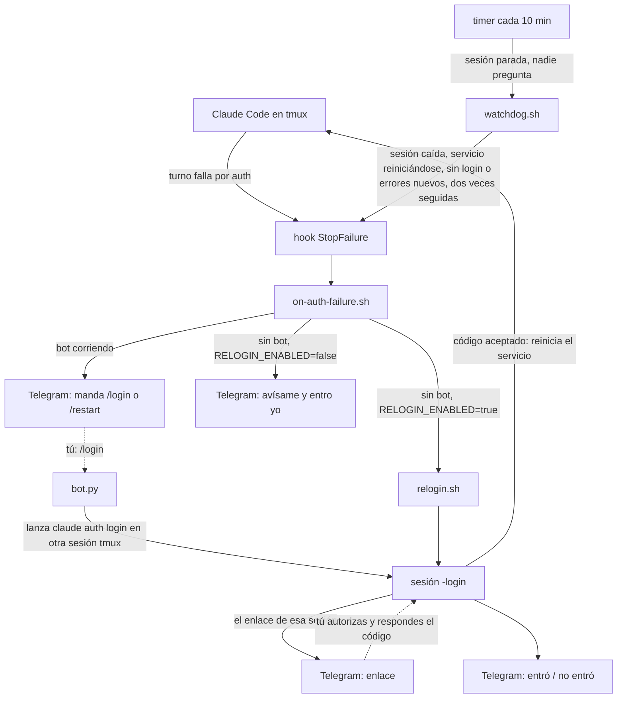

# Claude Code login watcher

Una sesión de Claude Code corriendo en un servidor —en tmux, en modo Remote
Control— deja de funcionar cuando caduca el login. No se recupera sola, y nadie
se entera hasta que se intenta usar y aparece esto:

```
Login expired · Please run /login
```

Esto avisa por Telegram en cuanto pasa —también cuando el servicio se cae o
entra en bucle de reinicios— y te deja arreglarlo desde el propio chat: con
`/login` te manda el enlace de autorización, le respondes con el código y lo
escribe por ti; con `/restart`, `/update`, `/logs` y `/status` haces el resto
sin abrir una terminal.

La documentación de Anthropic lo dice sin rodeos: *"a Remote Control session
that outlives the login stops making progress once the credential expires and
can't recover until you sign in again"*.

## Cómo funciona



Dos caminos de detección porque hacen falta los dos:

- **El hook** `StopFailure` con matcher `authentication_failed` es el mecanismo
  oficial de Claude Code, y salta en el momento exacto del fallo. Pero necesita
  que haya un turno en marcha: si la sesión está parada, no salta.
- **El timer** cubre justo ese hueco: pregunta a `claude auth status`, mira si
  la sesión existe, si el servicio lleva reinicios nuevos y si el panel muestra
  errores nuevos. Avisa a la segunda comprobación mala seguida, no a la
  primera, porque el token de acceso caduca cada pocas horas y durante unos
  minutos `auth status` dice que no hay login aunque se renueve solo.

## Instalación

Hace falta `bash`, `curl`, `tmux`, `python3` y una sesión de Claude Code en
tmux. Nada de root.

```bash
git clone https://github.com/sefirosweb/claude-remote-control.git
cd claude-remote-control
./install.sh --timer --bot  # --timer: el respaldo; --bot: los comandos por Telegram
```

Sin opciones instala solo los scripts. Vuelve a ejecutarlo después de cada
`git pull`: sustituye los scripts y reinicia el bot si estaba corriendo.

### 1. El bot de Telegram

1. Habla con [@BotFather](https://t.me/BotFather), `/newbot`, y guarda el token.
2. Escríbele algo a tu bot nuevo (si no, no puede contestarte).
3. Saca tu `chat_id`:

```bash
curl -s "https://api.telegram.org/bot<TOKEN>/getUpdates" | grep -o '"id":[0-9-]*' | head -1
```

### 2. La configuración

En `~/.config/claude-login-watch/config` (lo crea el instalador con permisos
600). Lo mínimo es el token, el `chat_id` y el nombre de tu sesión de tmux,
que sale de `tmux ls`:

```bash
TELEGRAM_BOT_TOKEN="123456:ABC-DEF..."
TELEGRAM_CHAT_ID="123456789"
TMUX_SESSION="claude-remote-control-session"
RELOGIN_ENABLED="false"
```

### 3. Comprobarlo antes de necesitarlo

```bash
~/.local/share/claude-login-watch/bin/watchdog.sh --test
```

Dice qué configuración está leyendo, si encuentra la sesión, el estado del
servicio, si el bot corre, la versión de Claude Code, si hay login, qué se ve
en el panel, y te manda un mensaje de prueba. Si no llega, no sigas: lo que
falla es el canal. Con el bot instalado, manda `/status` desde Telegram: es la
misma comprobación, hecha desde el otro lado.

### 4. El hook

En `~/.claude/settings.json` (o en el `settings.json` del proyecto). Si ya
tienes otros hooks, añade solo la entrada `StopFailure`:

```json
{
  "hooks": {
    "StopFailure": [
      {
        "matcher": "authentication_failed",
        "hooks": [
          {
            "type": "command",
            "command": "~/.local/share/claude-login-watch/bin/on-auth-failure.sh"
          }
        ]
      }
    ]
  }
}
```

## Opciones

Todas van en `~/.config/claude-login-watch/config`.

| Opción | Para qué | Por defecto |
|---|---|---|
| `TELEGRAM_BOT_TOKEN` | El bot que te escribe | — |
| `TELEGRAM_CHAT_ID` | Tu chat. Es el único que se lee y el único al que se contesta | — |
| `TMUX_SESSION` | La sesión a vigilar, de `tmux ls` | `claude` |
| `RELOGIN_ENABLED` | `true` para que el login arranque solo al caducar (sin bot) | `false` |
| `RELOGIN_WINDOW_SECONDS` | Cuánto espera tu código antes de rendirse, con o sin bot | `300` |
| `FAIL_THRESHOLD` | Comprobaciones malas seguidas (cada 10 min) antes de avisar | `2` |
| `LOGIN_FLAGS` | Tipo de cuenta para `claude auth login` (`--claudeai`, `--console`, `--sso`) | `--claudeai` |
| `REMOTE_SERVICE` | Unidad systemd de usuario que se reinicia tras entrar | `claude-remote.service` |
| `CLAUDE_BIN` | Ruta al binario `claude` | el del `PATH` o `~/.local/bin/claude` |
| `CODE_PATTERN` | Qué se acepta como código | alfanumérico, 16+ |
| `STATE_DIR` | Dónde van el log y los marcadores | `~/.local/state/…` |

El re-login **no** escribe `/login` en la sesión vigilada: si esa sesión corre
`claude remote-control` no hay ningún prompt donde escribirlo y el enlace nunca
aparece. Por eso lanza `claude auth login` en una sesión tmux aparte
(`<TMUX_SESSION>-login`), comprueba con `claude auth status` que entró y
reinicia `REMOTE_SERVICE` para que remote-control coja la credencial nueva.

## El bot de Telegram

Se enciende con `./install.sh --bot` y queda como servicio de usuario
(`claude-telegram-bot.service`). Pregunta a Telegram por mensajes nuevos —no
abre ningún puerto— y solo hace caso a tu `chat_id`:

| Comando | Qué hace |
|---|---|
| `/status` | Login, versión instalada frente a la última publicada, estado del servicio y de la sesión |
| `/login` | Lanza `claude auth login`, te manda el enlace y espera tu código |
| `/restart` | Reinicia `REMOTE_SERVICE` |
| `/update` | Ejecuta `claude update` y, si cambió la versión, reinicia el servicio |
| `/logs` | Últimas líneas del panel y del journal del servicio |
| `/cancel` | Olvida un `/login` pendiente |
| `/help` | La lista |

Con el bot corriendo, el aviso de caducidad cambia: en vez de mandarte un
enlace a las tres de la mañana que caduca en cinco minutos, te dice que mandes
`/login` cuando puedas. El enlace llega entonces, cuando estás al teléfono. Si
el servicio se cae o entra en bucle de reinicios, el aviso te manda a `/logs`
y `/restart`.

Lo que se escribe en una terminal sigue siendo solo tu código, solo mientras
hay un `/login` pendiente y solo si casa con `CODE_PATTERN`. Los comandos son
una lista cerrada: no hay forma de mandar un comando de shell.

Lo que no ve un mensaje enviado mientras el bot estaba parado, no se ejecuta:
un `/restart` de anoche no debe dispararse al arrancar, ni un código viejo
escribirse. Mándalo otra vez.

## El re-login automático, sin bot

Es el camino cuando el bot no está corriendo. Está **apagado por defecto**;
para encenderlo, `RELOGIN_ENABLED="true"`.

Con él encendido, cuando caduca el login recibes el enlace, lo abres, apruebas
el acceso y respondes al bot con el código. El script lo escribe en la sesión de
login, comprueba que entró, reinicia el servicio y te dice si entró.

Si el bot está corriendo, `relogin.sh` no arranca aunque `RELOGIN_ENABLED` sea
`true`: dos lectores de los mismos mensajes se los pelean (Telegram devuelve
`409 Conflict`), y con el bot ya pides el enlace tú con `/login`.

El enlace se comprueba antes de salir: si no lleva `state` y `code_challenge`
no se envía, porque el TUI lo pinta en varias líneas y un enlace a medias te
manda al navegador para que descubras allí que no sirve.

Decide tú si te compensa, porque tiene coste:

- **El código de autorización pasa por Telegram**, que es un tercero. Es de un
  solo uso y dura poco, pero es una credencial.
- **Durante esa ventana, lo que escribas en el chat acaba en tu terminal.** Se
  acota bastante: solo se escucha el `chat_id` configurado, solo cuentan los
  mensajes posteriores a lanzar el login, solo se acepta texto que case con
  `CODE_PATTERN`, la ventana dura cinco minutos y el texto se escribe con
  `tmux send-keys -l`, que lo manda literal y no interpreta nombres de teclas.
  Aun así, es una ventana.

Lo que **no** hace, a propósito: abrir ningún puerto. Es el servidor el que
pregunta a Telegram, no al revés. No hay nada escuchando a lo que llegar.

## La alternativa que no sirve

La solución obvia sería `claude setup-token`, que da un token OAuth de un año.
No vale aquí: ese token *"can only make model requests, so it can't establish
Remote Control sessions or fetch claude.ai connectors"*. Lo cambias por perder
el Remote Control y los conectores de claude.ai, que suele ser justo lo que
hacía útil la sesión.

## Si te lo instala un agente

Casi todo esto lo puede hacer un Claude Code con acceso al servidor. Lo que no,
es porque hace falta un navegador o porque implica una credencial que no debe
pasar por un chat.

**Lo puede hacer el agente:**

1. `git clone` y `./install.sh --timer --bot`
2. Averiguar `TMUX_SESSION` con `tmux ls` y escribirlo en la configuración
3. Leer el `chat_id` con `getUpdates` y guardarlo (después del paso 2 humano)
4. Añadir el hook `StopFailure` a `~/.claude/settings.json`, **con copia de
   seguridad previa** y sin tocar los hooks que ya hubiera
5. Ejecutar las tres pruebas de abajo

**Lo tiene que hacer la persona:**

1. Crear el bot en [@BotFather](https://t.me/BotFather) y escribirle un mensaje
2. Meter el token en la configuración sin pegarlo en ningún chat:

   ```bash
   read -s -p "token: " T && sed -i "s|^TELEGRAM_BOT_TOKEN=.*|TELEGRAM_BOT_TOKEN=\"$T\"|" \
       ~/.config/claude-login-watch/config && unset T && echo " guardado"
   ```

3. El día que caduque: abrir el enlace, aprobar y responder el código

**Para el agente, dos reglas:** el token no se imprime ni se pide por chat —
solo se usa desde el fichero—, y el re-login desde Telegram (el bot, o
`RELOGIN_ENABLED="true"`) se enciende cuando la persona lo diga, no por
iniciativa propia: mete sus códigos de autorización en un canal de terceros.

## Probarlo sin esperar a que caduque

Las tres pruebas que conviene hacer el día que lo instalas, no el día que falla.

**1. El canal.**

```bash
~/.local/share/claude-login-watch/bin/watchdog.sh --test
```

**2. El vigilante**, con una sesión que finge estar caducada:

```bash
tmux new-session -d -s prueba-expirada "printf 'Login expired · Please run /login\n'; sleep 300"
sed 's|^TMUX_SESSION=.*|TMUX_SESSION="prueba-expirada"|' \
    ~/.config/claude-login-watch/config > /tmp/config-prueba
chmod 600 /tmp/config-prueba
CLAUDE_LOGIN_WATCH_CONFIG=/tmp/config-prueba \
    ~/.local/share/claude-login-watch/bin/watchdog.sh
tmux kill-session -t prueba-expirada
```

**3. El hook**, provocando un fallo de autenticación de verdad en un proceso
aparte. Tu sesión no se entera, porque la variable solo existe para ese proceso:

```bash
ANTHROPIC_API_KEY="sk-ant-no-vale" claude -p "di hola"
rm -f ~/.local/state/claude-login-watch/warned   # importante
```

Ese `rm` no es opcional: el marcador que evita avisos repetidos silenciaría un
aviso de verdad durante seis horas.

Para probar el re-login entero sin tocar tu sesión, arranca otro Claude en una
sesión aparte y apunta ahí un `TMUX_SESSION` de prueba, como en el punto 2.

## Lo más eficaz es no llegar a caducar

Claude Code avisa tres días antes, al arrancar:

```
Your login expires in 3 days · run /login to renew
```

Y `/status` muestra una fila `Login` con el estado. Si renuevas al ver el aviso,
nada de esto hace falta. Esto es la red por debajo, no el plan.

## Ficheros

```
bin/common.sh           configuración, log, y todo lo que toca tmux, systemd y claude
bin/on-auth-failure.sh  lo que llama el hook: avisa una vez por incidencia y decide quién actúa
bin/relogin.sh          el re-login automático, sin bot
bin/bot.py              el bot de Telegram: /status, /login, /restart, /update, /logs
bin/watchdog.sh         el respaldo del timer, y --test
systemd/                service + timer del respaldo, service del bot
config.example          la configuración, comentada
```

Los logs viven en `~/.local/state/claude-login-watch/`: `watch.log` (hook y
timer) y `bot.log` (el bot, que también escribe en el journal). No guardan ni
el token, ni el `chat_id`, ni el código.

El token está en el fichero de configuración, con permisos 600, y no sale de
ahí: no se escribe en el log y no se pasa a `curl` como argumento, porque los
argumentos de un proceso los puede leer cualquiera que haga `ps`. Va por stdin
como fichero de configuración de `curl`. Lo que esto **no** hace es protegerte
de alguien que ya tenga tu usuario: quien pueda leer el fichero, lo tiene.

## Resolución de problemas

| Síntoma | Qué mirar |
|---|---|
| El mensaje de prueba no llega | Token o `chat_id` mal, o no le has escrito al bot primero |
| `tmux: NOT FOUND` | `TMUX_SESSION` no coincide con lo que lista `tmux ls` |
| Avisa de más | Baja `REWARN_AFTER` en `on-auth-failure.sh` o revisa si la sesión entra y sale |
| Manda el enlace pero no pasa nada al responder | Mira el log: si dice *does not look like a code*, ajusta `CODE_PATTERN` |
| No avisa aunque la sesión esté caída | Comprueba el timer: `systemctl --user list-timers claude-login-watch.timer` |
| Avisa de "logged out" y a los diez minutos "is back" | Es el token renovándose. Sube `FAIL_THRESHOLD` a `3` |
| El bot no contesta | `systemctl --user status claude-telegram-bot.service` y `journalctl --user -u claude-telegram-bot.service` |
| El log del bot dice `409` | Otro proceso lee los mensajes del mismo bot (un `relogin.sh` suelto, u otro servidor con el mismo token). Un bot por servidor |
| `/status` dice "could not check for updates" | No llega a `registry.npmjs.org`. `/update` funciona igual |

## Licencia

MIT.
