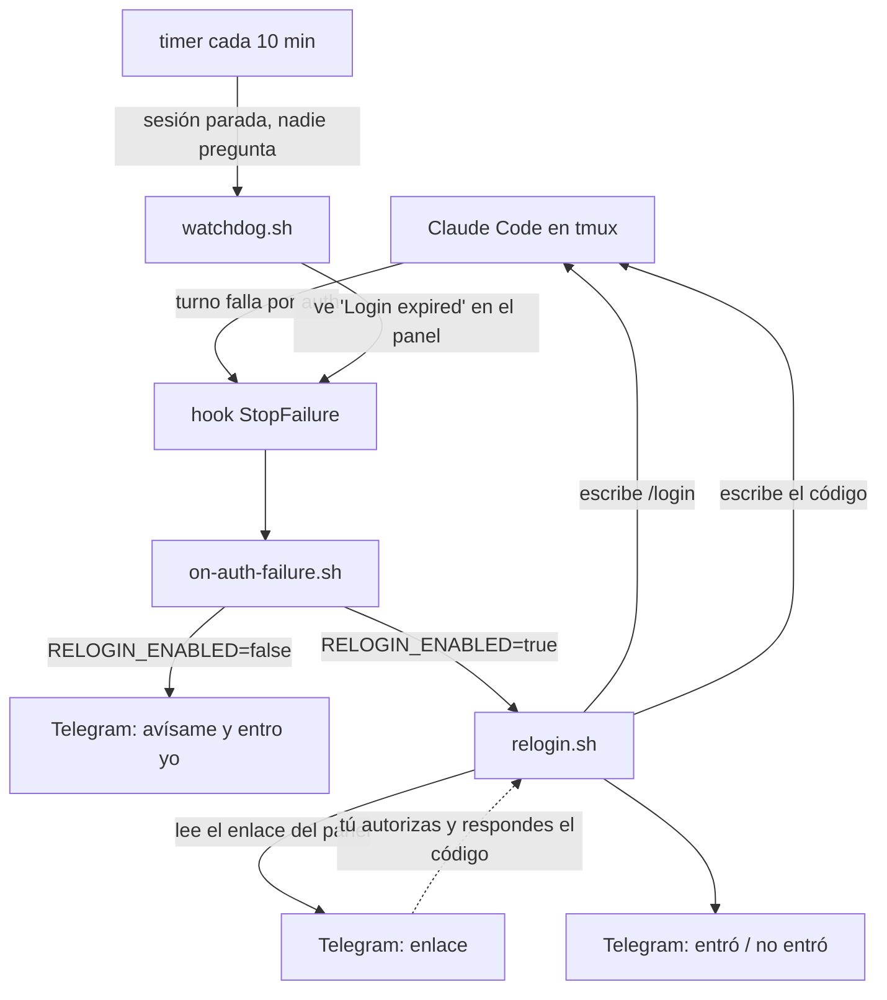

# Claude Code login watcher

Una sesión de Claude Code corriendo en un servidor —en tmux, en modo Remote
Control— deja de funcionar cuando caduca el login. No se recupera sola, y nadie
se entera hasta que se intenta usar y aparece esto:

```
Login expired · Please run /login
```

Esto avisa por Telegram en cuanto pasa y, si quieres, te deja volver a entrar
desde el propio chat: te manda el enlace de autorización, le respondes con el
código y lo escribe por ti en la sesión.

La documentación de Anthropic lo dice sin rodeos: *"a Remote Control session
that outlives the login stops making progress once the credential expires and
can't recover until you sign in again"*.

## Cómo funciona



Dos caminos de detección porque hacen falta los dos:

- **El hook** `StopFailure` con matcher `authentication_failed` es el mecanismo
  oficial de Claude Code, y salta en el momento exacto del fallo. Pero necesita
  que haya un turno en marcha: si la sesión está parada, no salta.
- **El timer** cubre justo ese hueco mirando lo que muestra el panel.

## Instalación

Hace falta `bash`, `curl`, `tmux`, `python3` y una sesión de Claude Code en
tmux. Nada de root.

```bash
git clone https://github.com/sefirosweb/claude-remote-control.git
cd claude-remote-control
./install.sh --timer        # sin --timer instala solo los scripts
```

### 1. El bot de Telegram

1. Habla con [@BotFather](https://t.me/BotFather), `/newbot`, y guarda el token.
2. Escríbele algo a tu bot nuevo (si no, no puede contestarte).
3. Saca tu `chat_id`:

```bash
curl -s "https://api.telegram.org/bot<TOKEN>/getUpdates" | grep -o '"id":[0-9-]*' | head -1
```

### 2. La configuración

En `~/.config/claude-login-watch/config` (lo crea el instalador con permisos
600). Lo mínimo es el token, el `chat_id` y el nombre de tu sesión de tmux,
que sale de `tmux ls`:

```bash
TELEGRAM_BOT_TOKEN="123456:ABC-DEF..."
TELEGRAM_CHAT_ID="123456789"
TMUX_SESSION="claude-remote-control-session"
RELOGIN_ENABLED="false"
```

### 3. Comprobarlo antes de necesitarlo

```bash
~/.local/share/claude-login-watch/bin/watchdog.sh --test
```

Dice qué configuración está leyendo, si encuentra la sesión, qué se ve en el
panel, y te manda un mensaje de prueba. Si no llega, no sigas: lo que falla es
el canal.

### 4. El hook

En `~/.claude/settings.json` (o en el `settings.json` del proyecto). Si ya
tienes otros hooks, añade solo la entrada `StopFailure`:

```json
{
  "hooks": {
    "StopFailure": [
      {
        "matcher": "authentication_failed",
        "hooks": [
          {
            "type": "command",
            "command": "~/.local/share/claude-login-watch/bin/on-auth-failure.sh"
          }
        ]
      }
    ]
  }
}
```

## El re-login desde Telegram

Está **apagado por defecto**. Para encenderlo, `RELOGIN_ENABLED="true"`.

Con él encendido, cuando caduca el login recibes el enlace, lo abres, apruebas
el acceso y respondes al bot con el código. El script lo escribe en la sesión y
te dice si entró.

Decide tú si te compensa, porque tiene coste:

- **El código de autorización pasa por Telegram**, que es un tercero. Es de un
  solo uso y dura poco, pero es una credencial.
- **Durante esa ventana, lo que escribas en el chat acaba en tu terminal.** Se
  acota bastante: solo se escucha el `chat_id` configurado, solo cuentan los
  mensajes posteriores a lanzar el `/login`, solo se acepta texto que case con
  `CODE_PATTERN`, la ventana dura cinco minutos y el texto se escribe con
  `tmux send-keys -l`, que lo manda literal y no interpreta nombres de teclas.
  Aun así, es una ventana.

Lo que **no** hace, a propósito: abrir ningún puerto. Es el servidor el que
pregunta a Telegram, no al revés. No hay nada escuchando a lo que llegar.

## La alternativa que no sirve

La solución obvia sería `claude setup-token`, que da un token OAuth de un año.
No vale aquí: ese token *"can only make model requests, so it can't establish
Remote Control sessions or fetch claude.ai connectors"*. Lo cambias por perder
el Remote Control y los conectores de claude.ai, que suele ser justo lo que
hacía útil la sesión.

## Lo más eficaz es no llegar a caducar

Claude Code avisa tres días antes, al arrancar:

```
Your login expires in 3 days · run /login to renew
```

Y `/status` muestra una fila `Login` con el estado. Si renuevas al ver el aviso,
nada de esto hace falta. Esto es la red por debajo, no el plan.

## Ficheros

```
bin/common.sh           configuración, log y acceso a tmux
bin/on-auth-failure.sh  lo que llama el hook: avisa una vez por incidencia
bin/relogin.sh          el flujo completo con Telegram
bin/watchdog.sh         el respaldo del timer, y --test
systemd/                service + timer de usuario
config.example          la configuración, comentada
```

El log vive en `~/.local/state/claude-login-watch/watch.log`. No guarda ni el
token, ni el `chat_id`, ni el código.

El token está en el fichero de configuración, con permisos 600, y no sale de
ahí: no se escribe en el log y no se pasa a `curl` como argumento, porque los
argumentos de un proceso los puede leer cualquiera que haga `ps`. Va por stdin
como fichero de configuración de `curl`. Lo que esto **no** hace es protegerte
de alguien que ya tenga tu usuario: quien pueda leer el fichero, lo tiene.

## Resolución de problemas

| Síntoma | Qué mirar |
|---|---|
| El mensaje de prueba no llega | Token o `chat_id` mal, o no le has escrito al bot primero |
| `tmux: NOT FOUND` | `TMUX_SESSION` no coincide con lo que lista `tmux ls` |
| Avisa de más | Baja `REWARN_AFTER` en `on-auth-failure.sh` o revisa si la sesión entra y sale |
| Manda el enlace pero no pasa nada al responder | Mira el log: si dice *does not look like a code*, ajusta `CODE_PATTERN` |
| No avisa aunque la sesión esté caída | Comprueba el timer: `systemctl --user list-timers claude-login-watch.timer` |

## Licencia

MIT.
